<!--
  This page uses the walkthrough layout. See docs/walkthroughs/writing-walkthroughs.md for the conventions.
-->

# Build your first collection website

You'll take sample metadata from the University of Idaho's [Psychiana Digital Collection](https://www.lib.uidaho.edu/digital/psychiana/) and turn it into a working, published collection site using the **CollectionBuilder-CSV** template.
You'll move between a few apps on your computer, and each step tells you which one you should be in.

You'll need a computer where you can install free software, and a free GitHub account (step 1).

## Get set up

When you finish this part you'll have a GitHub account, and the free software CollectionBuilder uses installed on your computer.

### Create a GitHub account
{: app="web" video="zNp6bqBDRr0"}

1. Go to [github.com/signup](https://github.com/signup) and create an account. The free plan is all you need.

2. Open the email GitHub sends you and verify your address.

> **Done when:** you can sign in at github.com, and your username shows in the top-right menu.

### Install the software
{: app="files" video="cvYQiJBHo3k"}

This step takes the longest.
Each link opens our install guide for that tool. Tick them off as you go.

- [ ] [Git](https://collectionbuilder.github.io/cb-docs/docs/software/git/)
- [ ] [GitHub Desktop](https://collectionbuilder.github.io/cb-docs/docs/software/git/#install-github-desktop)
- [ ] [Visual Studio Code (VS Code)](https://collectionbuilder.github.io/cb-docs/docs/software/texteditor/)
- [ ] [Ruby](https://collectionbuilder.github.io/cb-docs/docs/software/ruby/)
- [ ] [Jekyll](https://collectionbuilder.github.io/cb-docs/docs/software/jekyll/)
- [ ] [ImageMagick and Ghostscript](https://collectionbuilder.github.io/cb-docs/docs/software/optional/#imagemagick-and-ghostscript) (optional, only needed to make your own image derivatives)

> **Done when:** in a terminal, `ruby -v` and `jekyll -v` each print a version number.

#### Something went wrong

- Search the web for the exact error message you see, in quotes.
- Each install guide has troubleshooting notes for common problems.
- Still stuck? Ask in the [CollectionBuilder Discussion Forum](https://github.com/orgs/CollectionBuilder/discussions) or email the team at collectionbuilder.team@gmail.com.

## Make your own copy

When you finish this part you'll have your own copy of the CollectionBuilder-CSV template, on GitHub and on your computer, open in VS Code.

### Create your repository from the template
{: app="web" video="sjwhM7wGNYs"}

1. Make sure you're signed in to GitHub, then open the [collectionbuilder-csv template](https://github.com/CollectionBuilder/collectionbuilder-csv).

2. Choose **Use this template**, then **Create a new repository**.

   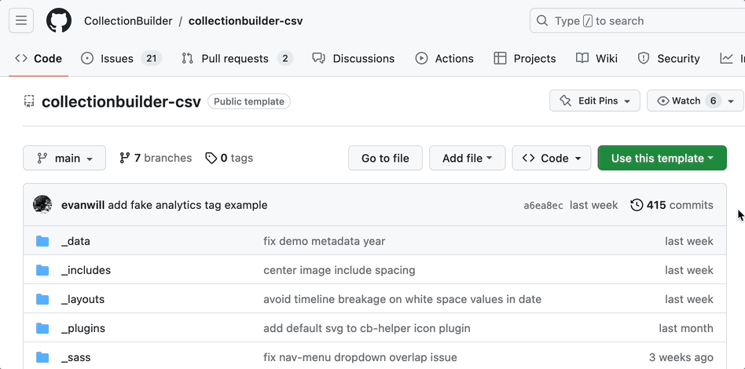

3. Leave it **Public**. Name it `your-repo` (lowercase, no spaces), then choose **Create repository from template**.

   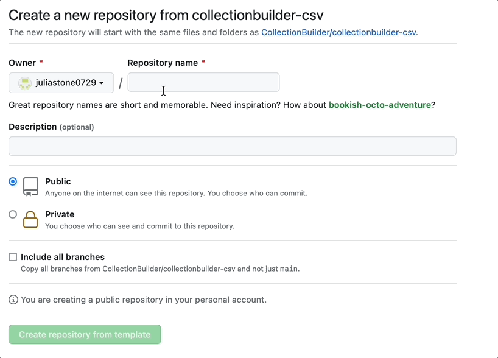

> **Done when:** your browser shows [github.com/your-username/your-repo](https://github.com/your-username/your-repo) with a list of files.

### Copy it to your computer (clone)
{: app="web desktop" video="OdHfBF0doN4"}

1. On your repository's page, choose the green **Code** button, then **Open with GitHub Desktop**.

   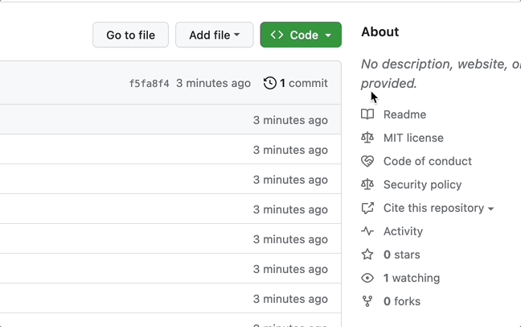

2. GitHub Desktop opens and asks where to save the repository. Keep the suggested folder (Documents/GitHub) and choose **Clone**.

   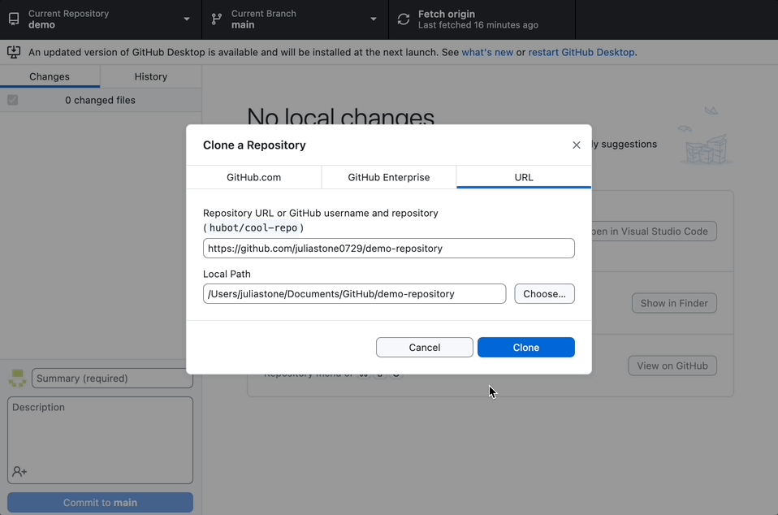

> **Done when:** GitHub Desktop shows `your-repo` under **Current Repository** in the top left.

#### Good to know: Fetch, Pull and Push

The button at the top right of GitHub Desktop keeps your computer and GitHub in sync.
**Fetch** checks for changes, **Pull** brings them down to your computer, and **Push** sends yours up.
If you work on more than one computer, or with other people, fetch and pull before you start.

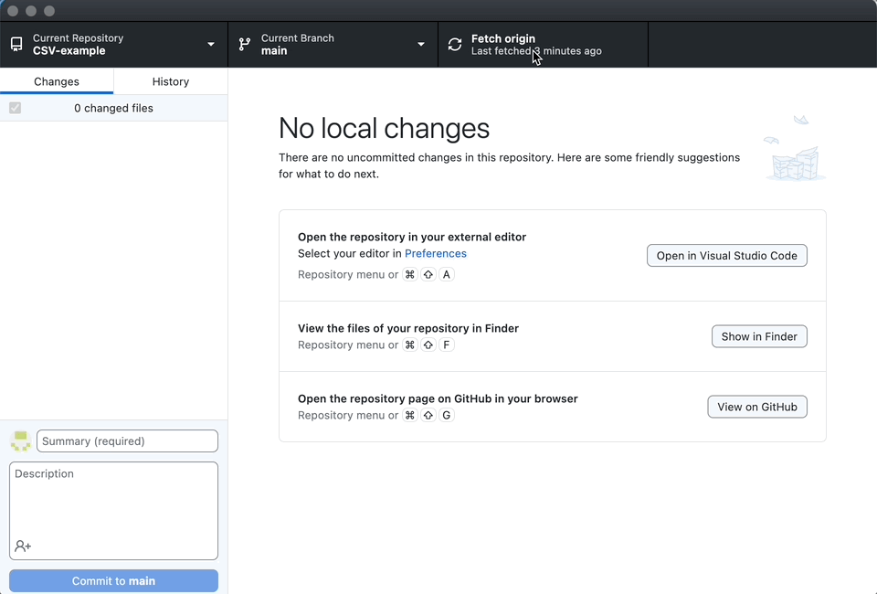

### Open the project in VS Code
{: app="desktop vscode" video="q4VBBUcwZpY"}

1. Check that **Current Repository** says `your-repo`.

2. From the menu bar, choose **Repository** → **Open in Visual Studio Code**.

   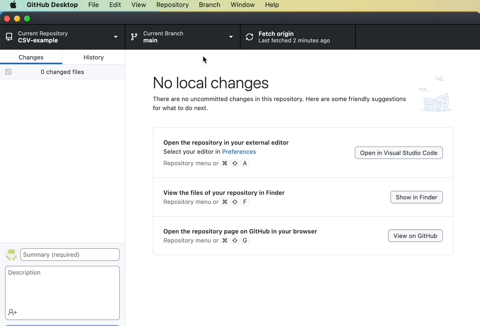

> **Done when:** VS Code opens, with `your-repo` at the top of the file list on the left.

#### Another way to open it

GitHub Desktop also shows an **Open in Visual Studio Code** button in the middle of the window.

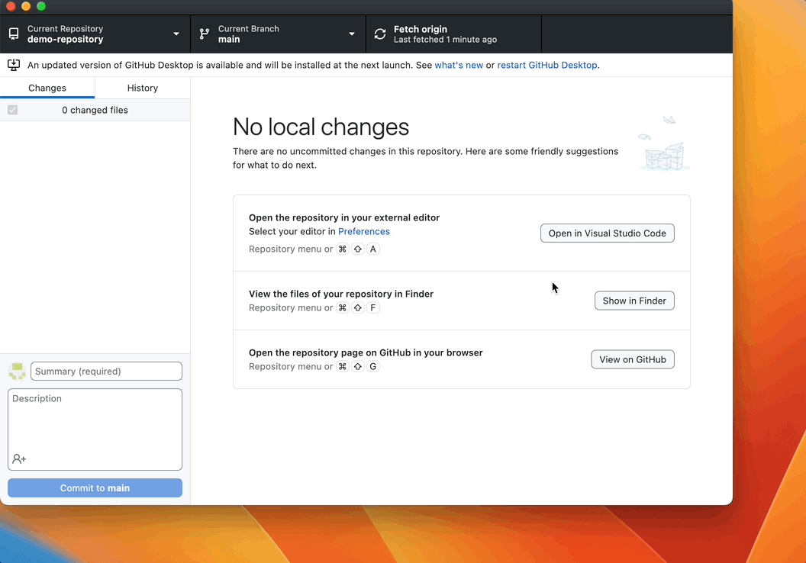

## Add your metadata

When you finish this part you'll have the collection's metadata in your project, and the site set up to use it.

> **Note:** The demo metadata links to images and media that are already online, so you won't add any object files to your project.
> When you build with your own collection, the [Object Derivatives Walkthrough](https://collectionbuilder.github.io/cb-docs/docs/walkthroughs/derivatives-walkthrough/) shows how ([video](https://www.youtube.com/watch?v=xgSnRN4aT9Q&list=PLt9zT3xACQo6aLD8ayLFOGp5T_mEw3tMQ)).

### Get the demo metadata as a CSV
{: app="sheets files" video="qG-7WtUtR4A"}

1. Make your own copy of the [Psychiana demo metadata](https://docs.google.com/spreadsheets/d/1U_DAC_YW_ryoJ2Ub6gEqxMXh3Y6xrDUIUbKjFqhBTsM/copy) in Google Sheets.

2. In your copy, choose **File** → **Download** → **Comma Separated Values (.csv)**.

   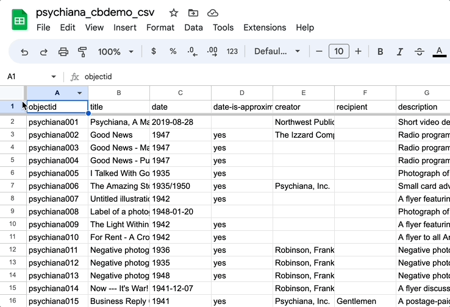

3. Find the file in your Downloads folder. Without opening it, rename it to `your-repo.csv`.

> **Careful:** Don't open the CSV in Excel. If Excel saves it, special characters will display wrongly on your site. It's super annoying! We know!

> **Done when:** your Downloads folder has a file named `your-repo.csv`.

### Add the CSV to your project
{: app="files vscode" video="u9WEx_nOBtM"}

1. In VS Code's file list, click the `_data` folder to open it.

   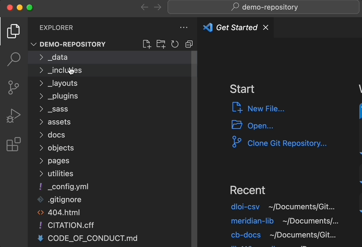

2. Drag `your-repo.csv` from your Downloads folder onto `_data`.

   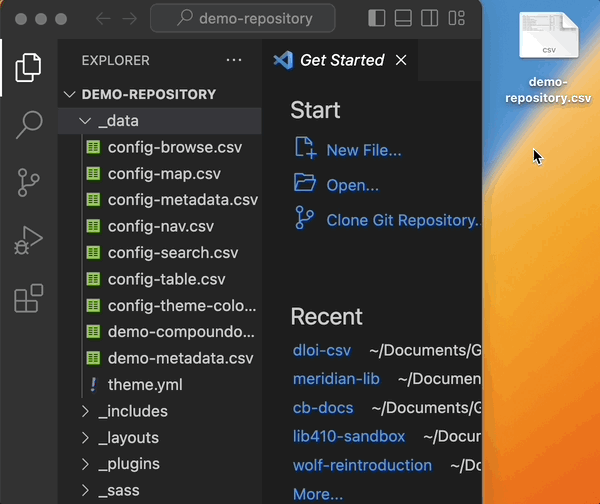

> **Done when:** `your-repo.csv` appears inside `_data` in VS Code's file list.

### Make a save point (commit)
{: app="vscode" video="h8mt9i6JoEI"}

A commit is a save point for your project.
You'll make one after every change from here on, so this step is worth learning well.

1. Open **Source Control**. It's the branching icon in the left-hand bar, or press Ctrl + Shift + G.

   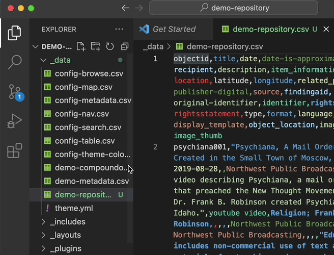

2. Hover over **Changes** and choose the **+** to stage everything.

3. Type a short message, like `Add metadata`, and choose **Commit**.

   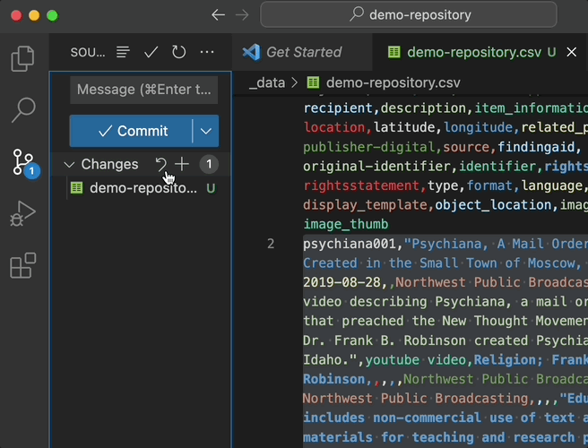

> **Done when:** the **Changes** list is empty.

#### Good to know: what does each icon do?

Hover over any icon in VS Code to see what it does.

### Point the site at your metadata
{: app="vscode" video="9K52tsTQq0o"}

1. Open `_config.yml`. Under **COLLECTION SETTINGS**, set `metadata` to your file name without `.csv`:

   ```yaml
   metadata: your-repo
   ```

   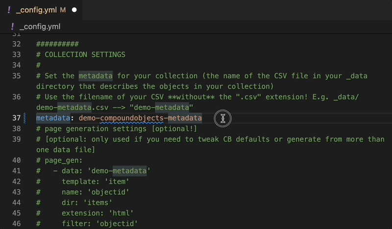

2. Under **SITE SETTINGS**, give your site a title:

   ```yaml
   title: Your Site Title
   ```

   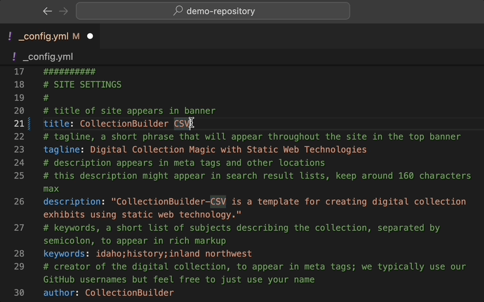

3. If you like, also fill in `tagline`, `description` and `author`. Then save with Ctrl/⌘ + S.

> **Save point:** Update site settings

> **Done when:** both lines match yours, and the `_config.yml` tab has no unsaved dot.

#### What else is in _config.yml?

Everything about how your site is built. See the [Site Config documentation](https://collectionbuilder.github.io/cb-docs/docs/config/).

## See it on your computer

When you finish this part you'll have your collection site running in your own browser, before anyone else can see it.

### Open the terminal
{: app="vscode" video="UH7JVpUZOoU"}

1. From the menu bar, choose **Terminal** → **New Terminal**.

   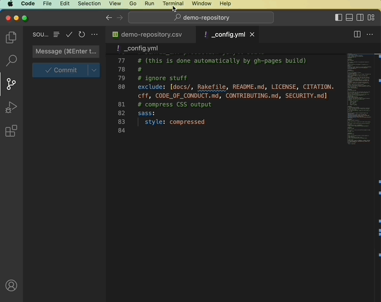

> **Done when:** a terminal panel opens at the bottom of VS Code, and the line ends with `your-repo`.

### Install the project's tools
{: app="term" video="iEsEy3Zf3Vo" badge="First time only"}

1. Type this and press Enter:

   ```
   bundle install
   ```

   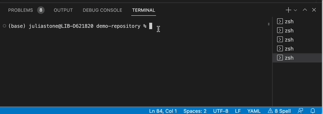

2. A lot of text scrolls past. That's normal. Wait for the prompt to come back.

> **Done when:** the terminal says `Bundle complete!` and you can type again.

#### Something went wrong

Errors here are almost always about Ruby.
Revisit the [Ruby install guide](https://collectionbuilder.github.io/cb-docs/docs/software/ruby/) and its troubleshooting notes.

### Start your site
{: app="term browser" video="Shqm2Uwk4K8"}

1. Type this and press Enter:

   ```
   bundle exec jekyll s
   ```

   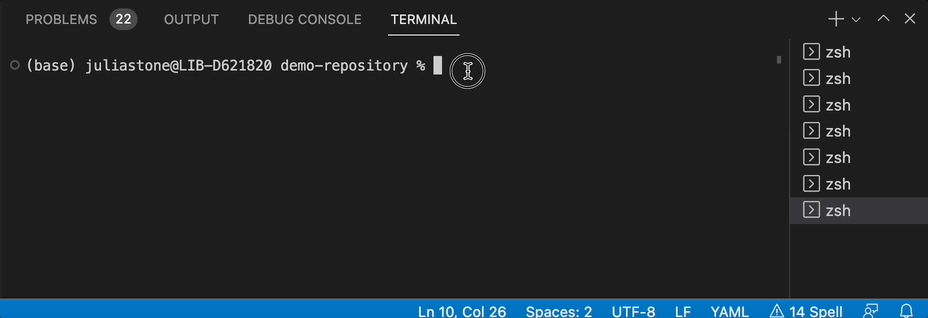

2. Wait for `Server address: http://127.0.0.1:4000/`. Hold Ctrl (or ⌘ on a Mac) and click it.

   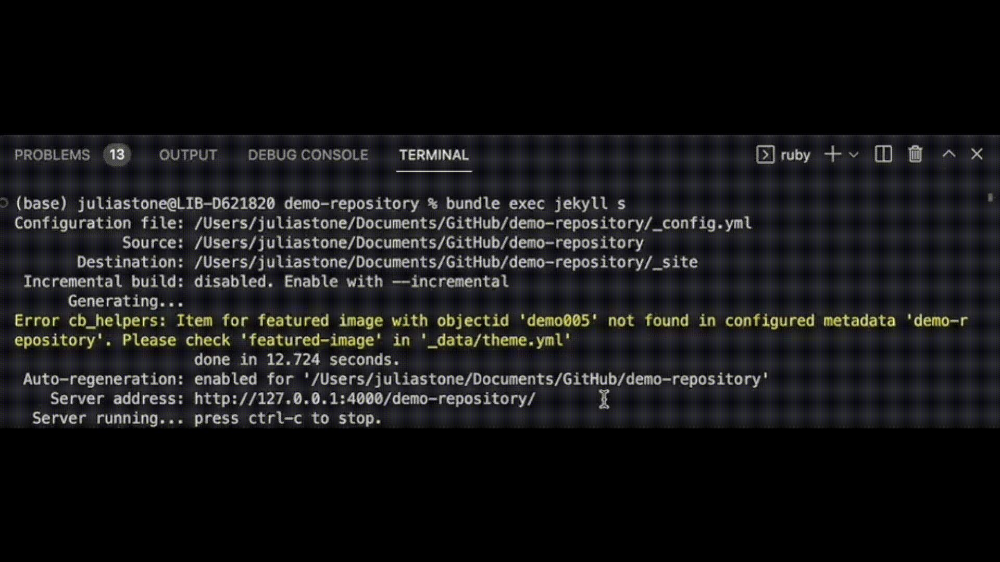

> **Done when:** your browser shows your collection's homepage, with items from Psychiana.

#### Good to know: rebuilding and stopping

- Leave the server running while you work. Each time you save a file, the site rebuilds, and you can refresh your browser to see it.
- Changes to `_config.yml` need a restart. Press Ctrl + C, then run the command again. Pressing the up arrow brings the last command back.
- Press Ctrl + C to stop the server when you're finished.
- Learn more in [Generate Your Site](https://collectionbuilder.github.io/cb-docs/docs/repository/generate/).

### Choose a homepage image
{: app="browser vscode" video="nZcBduxKLTM"}

1. On your local site, open **Browse** and pick a wide image.

   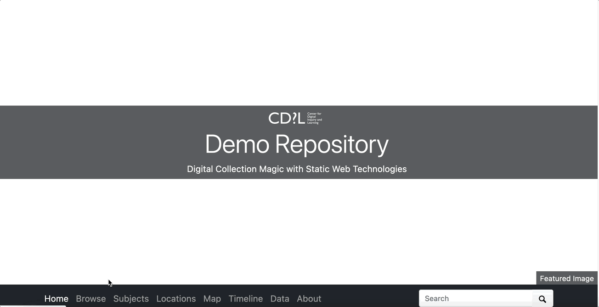

2. Open the item. Its ID is the end of the address, between `/items/` and `.html`. For example, `psychiana005`.

   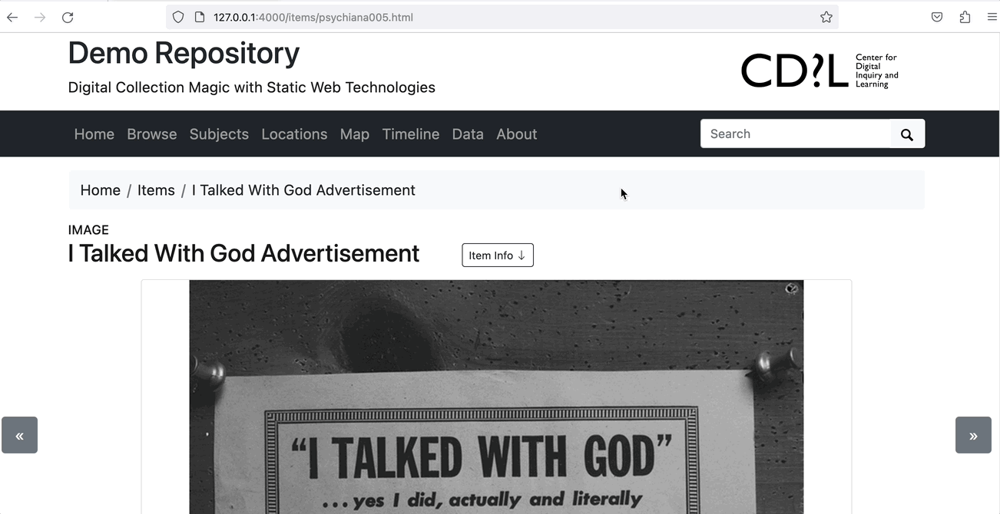

3. In VS Code, open `_data/theme.yml`. Under **HOME PAGE**, set `featured-image` to that ID:

   ```yaml
   featured-image: psychiana005
   ```

   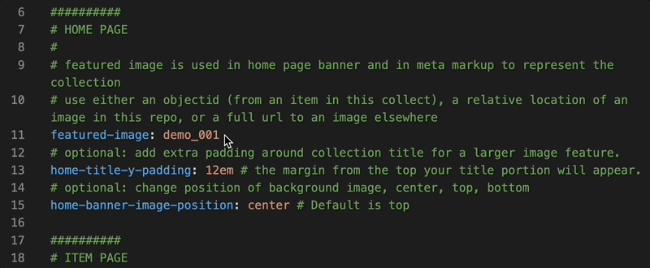

4. Save, then refresh your browser.

   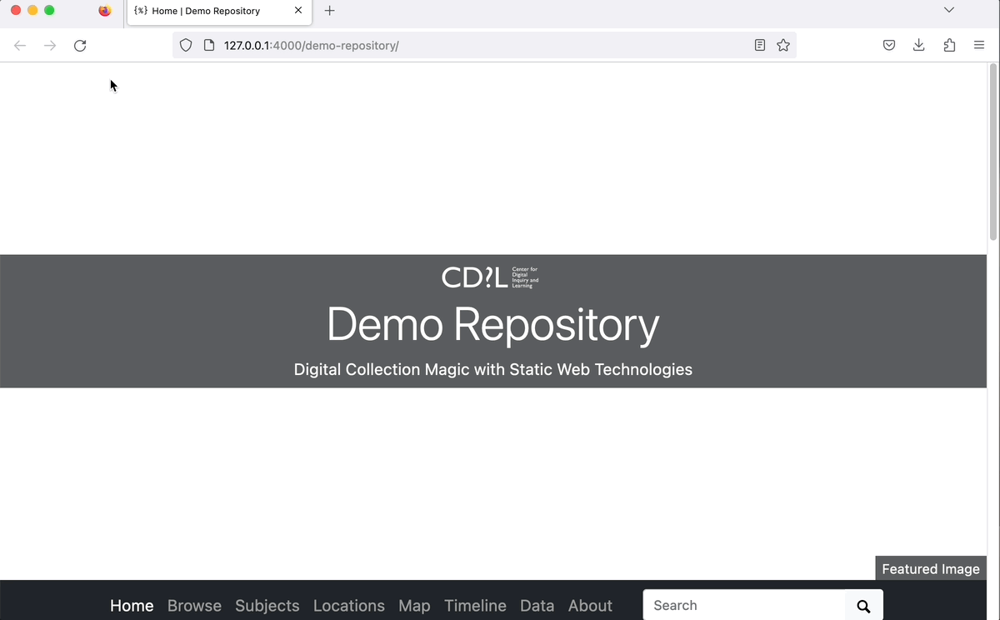

> **Save point:** Add featured image

> **Done when:** your homepage opens with the image you chose.

#### More ways to change the look

See [Theme Configuration](https://collectionbuilder.github.io/cb-docs/docs/theme/), [Configuring and Customizing Pages](https://collectionbuilder.github.io/cb-docs/docs/customization/), [Theme Colors](https://collectionbuilder.github.io/cb-docs/docs/customization/config-theme-colors/) and [Adding Custom CSS](https://collectionbuilder.github.io/cb-docs/docs/add-more/custom-css/).

### Write your About page
{: app="vscode" video="nCK_cuAz66U" badge="Optional"}

1. Open `pages/about.md` and write a few lines in [Markdown](https://collectionbuilder.github.io/cb-docs/docs/glossary/#markdown).

2. For ideas, try the examples on the [Feature Includes Bonanza](https://collectionbuilder.github.io/collectionbuilder-gh/feature_options.html) page.

> **Save point:** Update the About page

> **Done when:** your words show up on the About page of your local site.

## Publish it

When you finish this part you'll have your collection online at https://your-username.github.io/your-repo/.

### Tell the site where it will live
{: app="vscode" video="3LAtMRoTUx0"}

1. In `_config.yml`, find **URL VARIABLES** and set:

   ```yaml
   url: https://your-username.github.io
   baseurl: /your-repo
   ```

   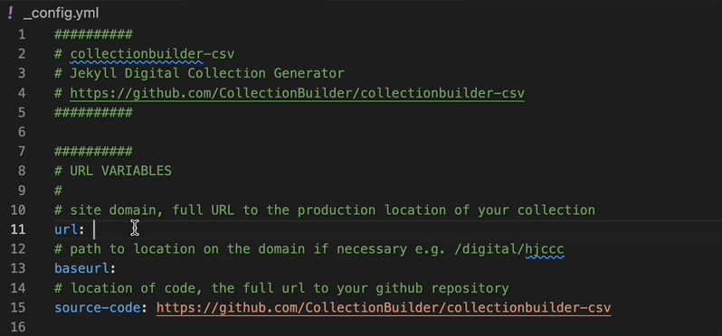

> **Save point:** Update URL variables

> **Done when:** your two lines match the ones above, and you've made a save point.

#### Hosting on your own server instead?

You can build the site yourself and copy the files to any web server.
See [Building Your Site](https://collectionbuilder.github.io/cb-docs/docs/deploy/build/).

### Send your save points to GitHub (sync)
{: app="vscode" video="YXLju-mJX-E"}

1. In **Source Control**, choose the blue **Sync Changes** button.

   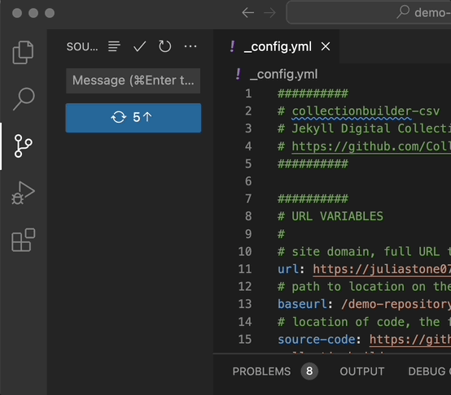

> **Done when:** on [github.com/your-username/your-repo](https://github.com/your-username/your-repo), the latest commit message is `Update URL variables`.

### Turn on publishing
{: app="web" video="__iuI5-PBpc"}

1. On your repository's page, choose **Settings** → **Pages**.

   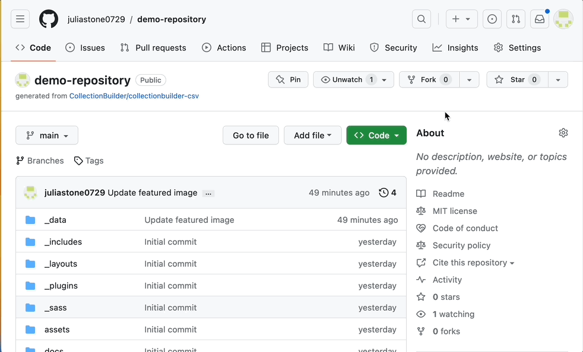

2. Under **Source**, choose **GitHub Actions**.

   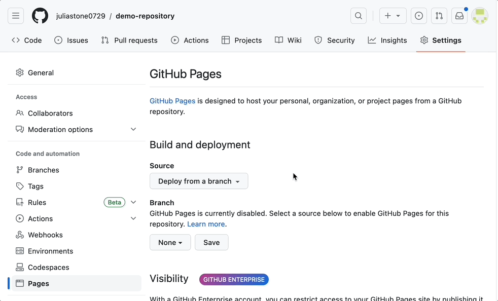

3. In the **Jekyll** box, choose **Configure**.

   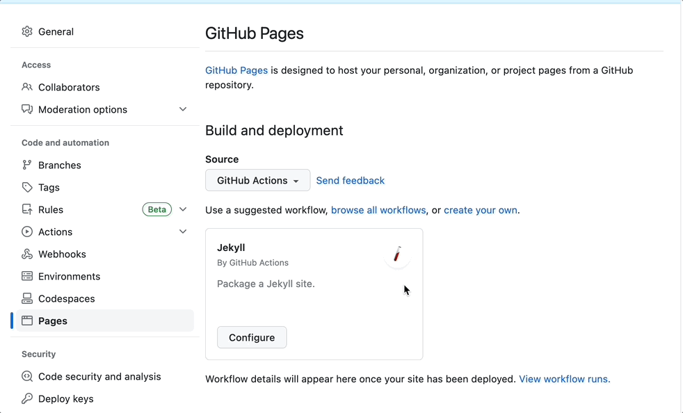

4. A file opens. You don't need to change it. Choose **Commit changes…**, then **Commit changes** again.

   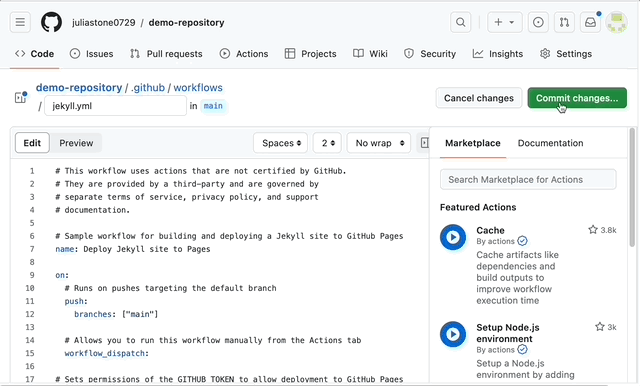

5. Wait a few minutes. Your address appears under **Settings** → **Pages**.

   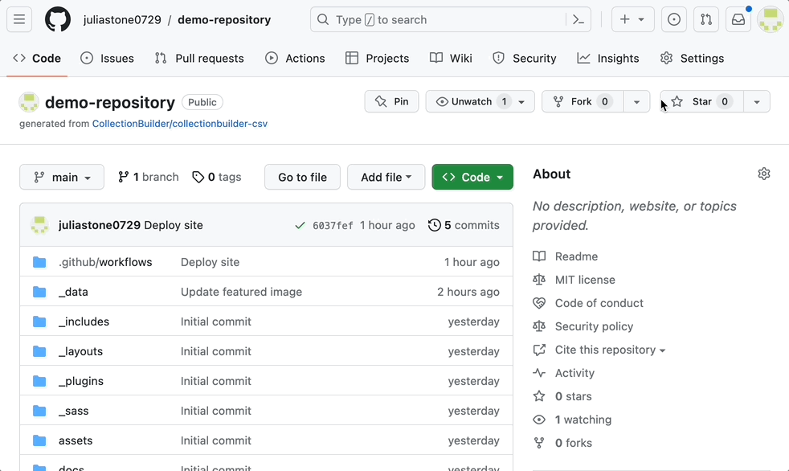

> **Done when:** [your-username.github.io/your-repo](https://your-username.github.io/your-repo/) shows your collection. From now on, every sync republishes it.

#### Something went wrong

- **No Actions tab?** Actions may be turned off for your account. Go to **Settings** → **Actions**, choose **Allow all actions**, and save.
- **Red ✕ next to your commit?** The build failed, and your last working site is still live. Open the **Actions** tab to read the error.

## What next?

You now have the whole loop: edit on your computer, preview it locally, make a save point, sync, and GitHub publishes.
Everything else builds on that loop.

- [Swap in your own metadata](https://collectionbuilder.github.io/cb-docs/docs/metadata/csv_metadata/)
- [Add your own image and PDF files](https://collectionbuilder.github.io/cb-docs/docs/walkthroughs/derivatives-walkthrough/)
- [Change theme options](https://collectionbuilder.github.io/cb-docs/docs/theme/) and [configure your pages](https://collectionbuilder.github.io/cb-docs/docs/customization/)
- [Add timelines, cloud pages, and more](https://collectionbuilder.github.io/cb-docs/docs/add-more/)

Stuck anywhere? Ask in the [CollectionBuilder Discussion Forum](https://github.com/orgs/CollectionBuilder/discussions) or email collectionbuilder.team@gmail.com.
