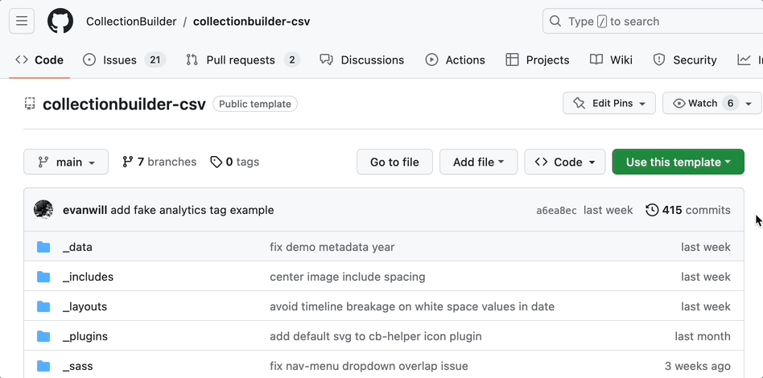
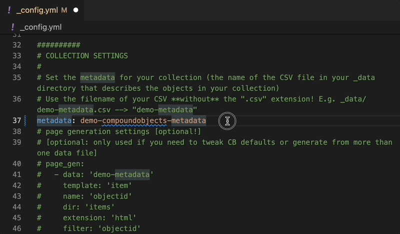

# Writing Walkthroughs

Walkthroughs are ordinary Markdown pages that use the `walkthrough` layout.
A small script turns them into parts, steps, checkpoints and a media pane.
If the script doesn't run, readers still get a complete, normal docs page, so you can always check your work in VS Code's Markdown preview or on GitHub.

See [csv-walkthrough.md](https://github.com/CollectionBuilder/cb-docs/blob/main/docs/walkthroughs/csv-walkthrough.md) for a full example, and [essay-walkthrough.md](https://github.com/CollectionBuilder/cb-docs/blob/main/docs/walkthroughs/essay-walkthrough.md) for a recipe-style one with ingredients and facts at the top.

If a walkthrough shows CB-Essay or Jekyll include tags as examples, wrap the whole page body in <code>{&#37; raw &#37;}</code> … <code>{&#37; endraw &#37;}</code> so Jekyll prints them instead of running them.

## Front matter

```yaml
---
title: CSV Walkthrough
parent: Walkthroughs
nav_order: 3
layout: walkthrough
playlist: PLt9zT3xACQo6aLD8ayLFOGp5T_mEw3tMQ   # optional, YouTube playlist ID
personalize:                                  # optional
  your-username: GitHub username
  your-repo: Repository name
---
```

Add `commit_in: github` when readers commit in the GitHub.com editor instead of VS Code, so save points give the right instructions.

`personalize` lists placeholder words and the label for the box where readers type their own value.
Wherever a placeholder appears in the page, in text, code, or link addresses, it's swapped for the reader's value.
Use plain words that make sense if nothing gets swapped, like `your-repo`, rather than `{repo}`.
Placeholders written in lowercase also lowercase what the reader types.

## The conventions

| Write this | You get |
|---|---|
| `# Title` and paragraphs before the first `##` | The introduction |
| `## Part name` | A new part. The first paragraph under it is "what you'll have when you finish this part". |
| `### Step name` followed by `{: app="web vscode" video="YouTube-ID"}` on the next line | A step, numbered automatically, with app labels and a video |
| A numbered list | The step's actions |
| An image indented under a numbered item | A clip in the media pane, with a "Show me" link on that action |
| `- [ ] item` | A checklist that remembers what's ticked |
| `> **Done when:** …` | The checkpoint and "Mark done" button. Every step should have one. |
| `> **Careful:** …` | A warning |
| `> **Save point:** commit message` | A reminder to commit, with the steps tucked inside |
| `> **Note:** …` | A side note. Under a `##` heading, before the first step, it introduces the part. |
| `#### Heading` | A collapsed section with everything below it, up to the next heading. Put these at the end of a step. |
| A `##` with no steps under it | Left as ordinary content where it is. Sections like this before the first step (such as "Ingredients") sit side by side at the top. |
| A definition list in the introduction (`Time` on one line, `: About an hour` on the next) | A row of facts under the title |

### App names

Use these keys in `app="…"`, separated by spaces, in the order the reader uses them:
`web` (GitHub.com), `desktop` (GitHub Desktop), `vscode` (VS Code), `term` (Terminal), `browser` (Browser), `sheets` (Google Sheets), `files` (Your computer).

Optional: `badge="Optional"` or `badge="First time only"` adds a small label next to the app names.

### Images

Write image paths from the root of the repository, starting with `/assets/`.
The layout adds the site's base URL and lazy loads them.
The alt text describes the image for screen readers.
The optional title in quotes is a short label for the media pane tab:

```markdown
2. Choose **Use this template**, then **Create a new repository**.

   
```

Indent the image (three spaces) and leave a blank line above it, so it stays attached to its numbered item.

## A complete step

~~~~markdown
### Point the site at your metadata
{: app="vscode" video="9K52tsTQq0o"}

1. Open `_config.yml`. Under **COLLECTION SETTINGS**, set `metadata` to your file name without `.csv`:

   ```yaml
   metadata: your-repo
   ```

   

> **Save point:** Update site settings

> **Done when:** the line matches yours, and the tab has no unsaved dot.

#### What else is in _config.yml?

Everything about how your site is built. See the Site Config documentation.
~~~~

## Writing tips

- Start each action with what to do: "Choose **Commit**", "Open `_config.yml`".
- Bold the names of things on screen, exactly as they appear.
- Write the "Done when" as something the reader can see on screen.
- Keep troubleshooting and background in `####` sections, so the main steps stay short.
