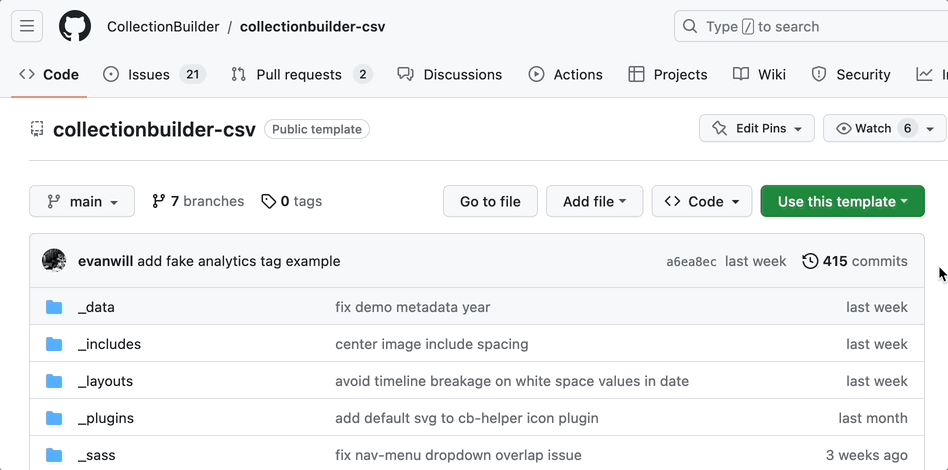
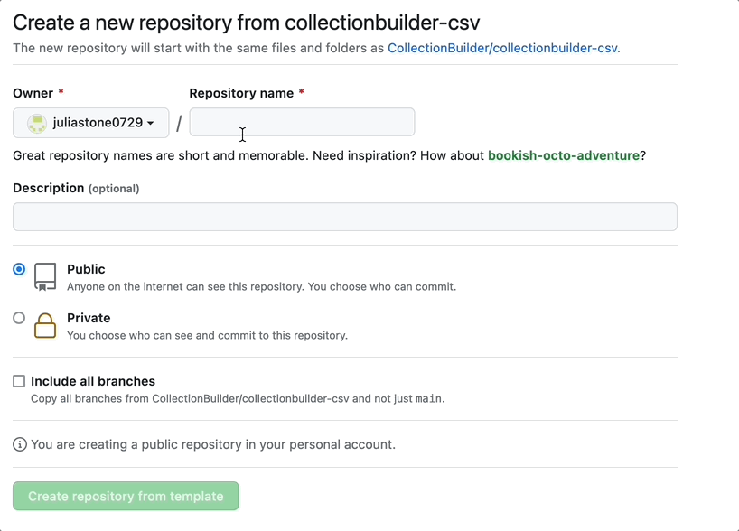
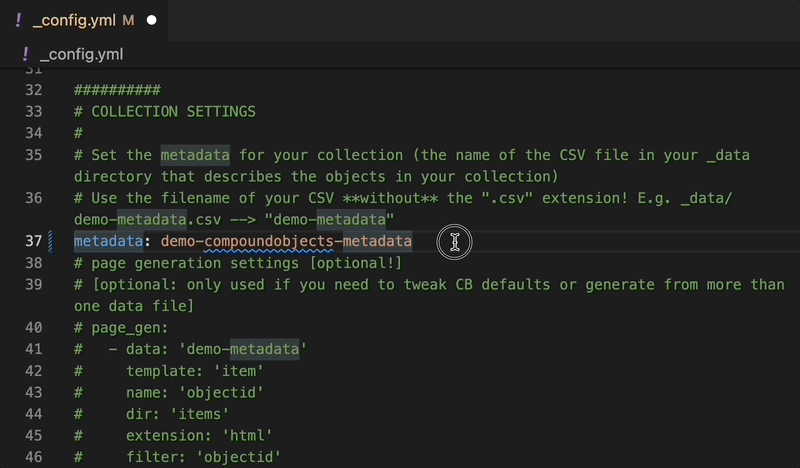
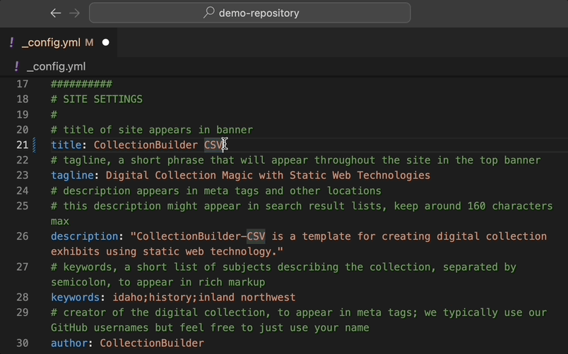

<!--
  Option B: one ordinary Markdown file with a few conventions.

  ## Part …          starts a part. The paragraph under it is the outcome.
  ### …              starts a step. The {: …} line under it says which app(s) and which video.
  1. 2. 3.           the actions. An image indented under an action becomes its clip
                     (moved to the media pane, with a "Show me" link left behind).
  > **Done when:**   the checkpoint.        > **Careful:**  a warning.
  > **Save point:**  a commit reminder.
  #### …             a collapsed "more" section (troubleshooting, good-to-know).
  your-repo, your-username
                     placeholder words listed under `personalize` above. They read
                     fine as-is, and the script swaps in the reader's own values.
                     (Curly-brace tokens get split up by code highlighting.)
  /assets/images/…   write the real repo path; the layout adds the site's baseurl.

  Without JavaScript this is still a complete, readable page: headings, numbered
  steps, images and quotes. The script only rearranges what is already there.
-->

# Build your first collection website

You'll turn real archival metadata into a working, published collection site.

## Part 2: Make your own copy

When you finish this part you'll have your own copy of the template, on GitHub and on your computer.

### Create your repository from the template
{: app="web" video="sjwhM7wGNYs"}

1. Make sure you're signed in, then open the [collectionbuilder-csv template](https://github.com/CollectionBuilder/collectionbuilder-csv).

2. Choose **Use this template**, then **Create a new repository**.

   

3. Leave it **Public**. Name it `your-repo`, then choose **Create repository from template**.

   

> **Done when:** your browser shows `github.com/your-username/your-repo` with a list of files.

## Part 3: Add your metadata

When you finish this part you'll have the metadata in your project, and the site set up to use it.

### Point the site at your metadata
{: app="vscode" video="9K52tsTQq0o"}

1. Open `_config.yml`. Under **COLLECTION SETTINGS**, set `metadata` to your file name without `.csv`:

   ```yaml
   metadata: your-repo
   ```

   

2. Under **SITE SETTINGS**, give your site a title:

   ```yaml
   title: Your Site Title
   ```

   

> **Save point:** Update site settings

> **Done when:** both lines match yours, and the tab has no unsaved dot.

#### What else is in _config.yml?

Everything about how your site is built. See the [Site Config docs](/docs/config/).
